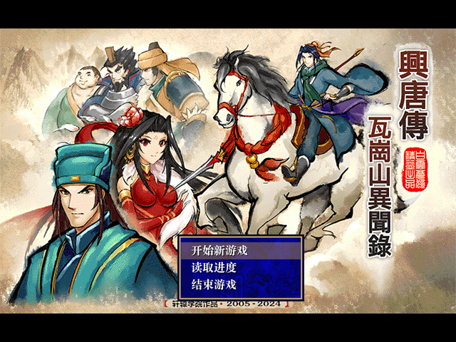
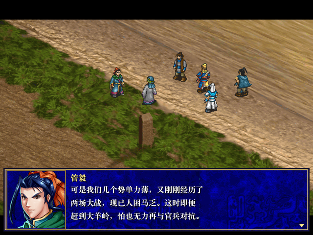
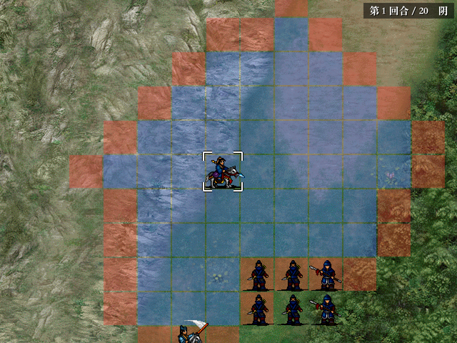
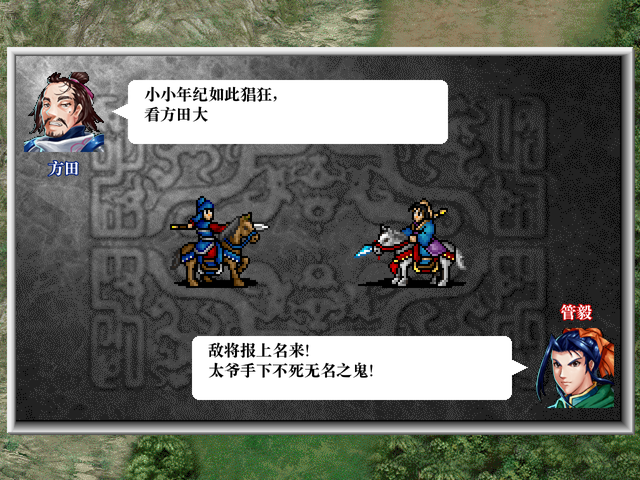

# 兴唐传·瓦岗山异闻录 — Godot reimplementation

A reverse-engineered reimplementation of **兴唐传·瓦岗山异闻录** (*Xing Tang Zhuan: Wagang Mountain Chronicles*), a
Sui–Tang story mod built on Koei's 1998 *三国志曹操传* (Cao Cao Zhuan) engine, rewritten in **Godot 4.7** so it runs
natively on macOS.

The original Windows executable was decompiled (Ghidra) and its formats, script language, battle formulas and AI
were documented, then re-implemented. The game's own data is used unchanged in converted form: all 117 story and
battle scripts, maps, sprites, portraits, music, sound effects and cutscenes.

<p align="center">
  
  
</p>
<p align="center">
  
  
</p>

## Features

* **Story scenes** – isometric towns and cutscenes, portraits and dialogue, captions, CG pictures, videos, branching
  choices, hub towns with shops and side quests, and the mod's 单挑 mini-games.
* **Tactical battles** – deployment and sortie selection, movement with zones of control, attacks, counters and
  double attacks, strategies with their animations, items, terrain and weather effects, experience and promotions,
  scripted battle events, and the original enemy AI.
* **Duels** – the 单挑 screen, re-implemented from the decompiled routines (intro, speech bubbles, every action and
  blow animation, EXP for the winner).
* **Saves** – 10 slots, usable from story scenes and mid-battle.
* **Multiple endings** – decided by the story flags and scores the scripts keep, exactly as in the original.

All 117 scripts have been run end to end by an automated play-through harness without script errors.

## Quick start

**Requirements:** macOS 10.13+ on Intel or 11+ on Apple Silicon, and [Godot 4.7](https://godotengine.org)
(`brew install --cask godot`). The converted game data is included in this repository.

```sh
git clone https://github.com/seedds/wagang-godot.git
cd wagang-godot
./run_game.sh                 # first run imports the project, then starts the game
```

To use Godot directly, import once with `godot --headless --path game --import`, then run `godot --path game`.
Without the import step the scripts' class names aren't registered and the game fails to start.

To build a standalone `.app`:

```sh
godot --headless --path game --import                          # first time only
godot --headless --path game --export-release "macOS" ../build/WaGang.app
open build/WaGang.app
```

The app is ad-hoc signed. If macOS refuses to open a copy that came from another machine, right-click it → **Open**,
or run `xattr -dr com.apple.quarantine WaGang.app`.

## Controls (summary)

| Input | Action |
|---|---|
| Left click / Enter | select, confirm, advance dialogue |
| Right click / Esc | cancel; open the menu (story: 菜单, battle: 回合结束 / save / load …) |
| Arrow keys | move the battle cursor |
| Mouse at screen edge, middle-drag | scroll the battle map |
| Hold Space or Ctrl | fast-forward |
| ⌘F / F11 / Alt+Enter | toggle full screen |

The full guide is in **[docs/PLAYING.md](docs/PLAYING.md)**.

## Documentation

| Document | Contents |
|---|---|
| [docs/PLAYING.md](docs/PLAYING.md) | Player guide: story scenes, battles, duels, menus, saving, troubleshooting |
| [docs/BUILDING.md](docs/BUILDING.md) | Rebuilding the converted assets from the original game, exporting the app |
| [docs/ARCHITECTURE.md](docs/ARCHITECTURE.md) | How the reimplementation works: emulated memory, script VM, stages, UI |
| [docs/DEVELOPMENT.md](docs/DEVELOPMENT.md) | Debug options, automated play-through tests, reverse-engineering workflow |
| [docs/README.md](docs/README.md) | Index of the reverse-engineering specifications (formats, script ops, rules, AI) |

## Repository layout

| Path | Contents |
|---|---|
| `game/` | The Godot project. `src/` = GDScript source, `assets/` = converted game data (loaded at runtime) |
| `docs/` | Guides and reverse-engineering specifications |
| `tools/` | Python converters, analysis helpers, Ghidra headless wrapper, test scripts |
| `run_game.sh` | Runs the game from source |

Not in the repository (see `.gitignore`): the original game (`wg2025/`), build output (`build/`) and scratch data
(`extract/`).

## Status and known differences

* The whole game is playable from the opening to the endings. Each script has been exercised automatically; long
  stretches have not yet been checked by a human play-through.
* Duel sprites are doubled with nearest-neighbour scaling instead of the original's edge-smoothing 2× filter.
* The original town toolbar is replaced by **菜单** / **出征** buttons in the top bar of story scenes.
* UI layout follows the original style but is not pixel-identical.

## Legal

This is an unofficial fan project for preservation and study, not affiliated with or endorsed by Koei Tecmo or the
mod's authors. *三国志曹操传* is © Koei Tecmo. The game content in `game/assets` (graphics, music, sound, video, text,
scripts) is converted from the original game and remains the property of its respective owners.

The repository has no license file yet, so the code is "all rights reserved" by default; add a `LICENSE` to make
the source in `game/src`, `tools` and `docs` reusable. Such a license would not cover `game/assets`.
