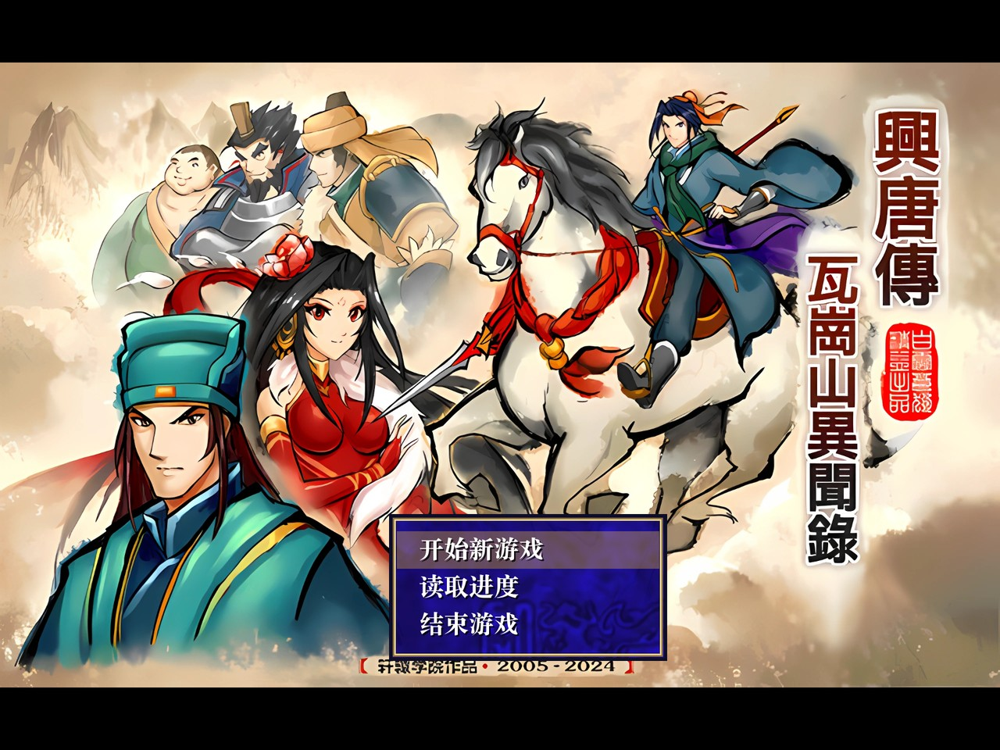
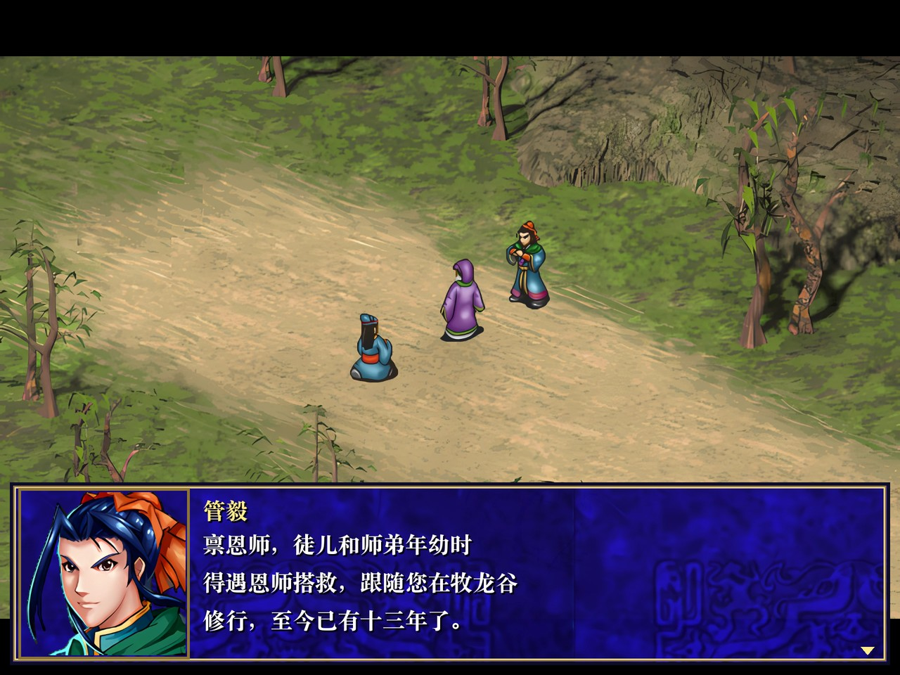
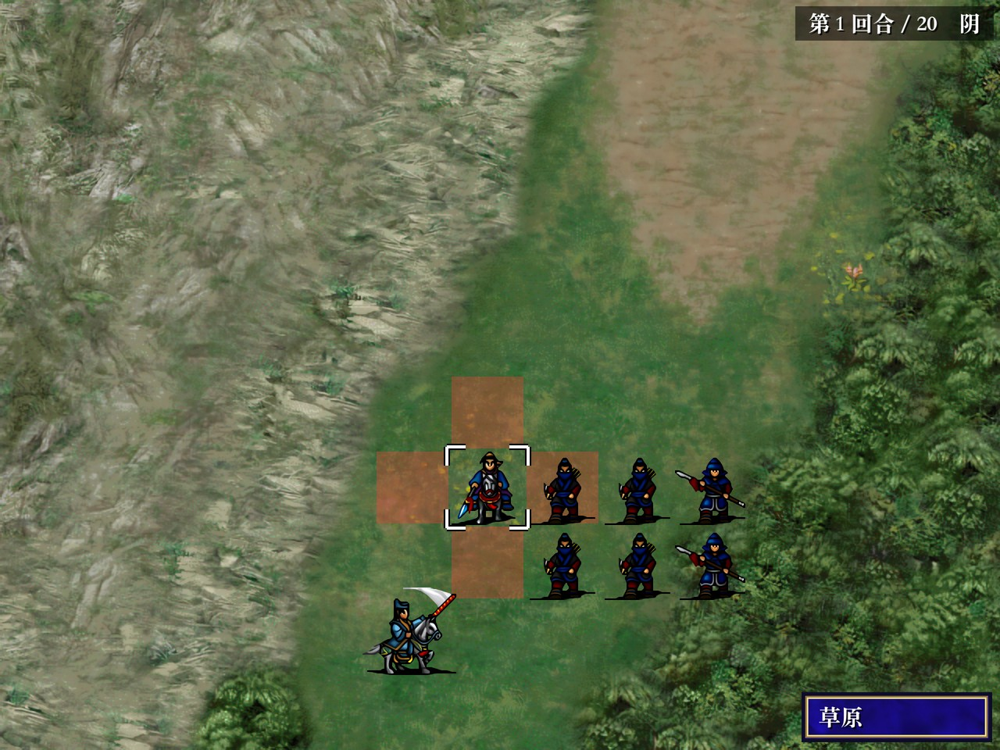
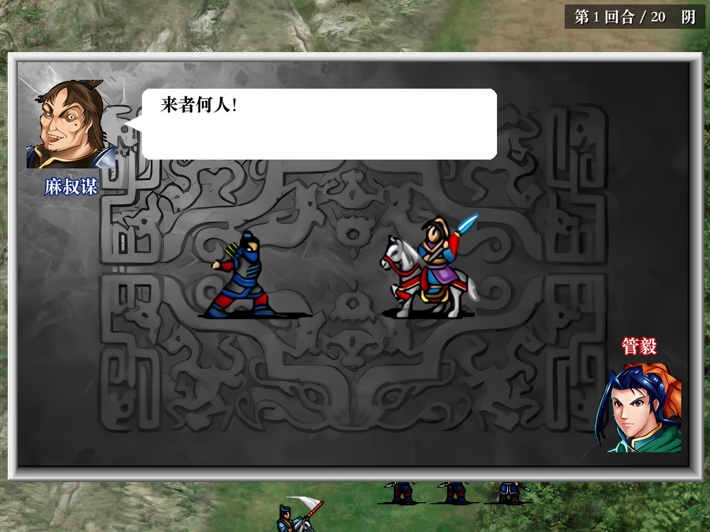
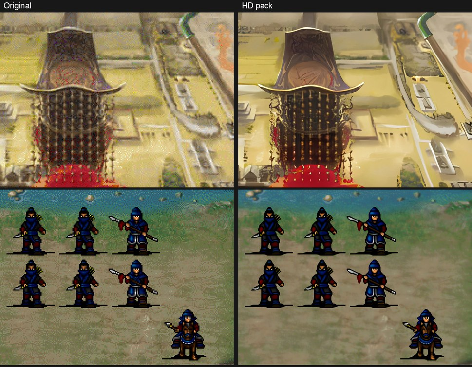

# 兴唐传·瓦岗山异闻录 — Godot 重制版

**中文** | [English](README.en.md)

本项目通过逆向工程，用 **Godot 4.7** 重新实现了 **《兴唐传·瓦岗山异闻录》**，使其可以在 **macOS** 和 **Windows** 上原生运行。
原作是基于光荣 1998 年《三国志曹操传》引擎制作的隋唐题材 MOD。

原版 Windows 程序经 Ghidra 反编译，其文件格式、剧本脚本语言、战斗公式和敌军 AI 都整理成了文档，再据此重新实现。
游戏数据全部来自原作，只做了格式转换、内容未作改动：117 个剧情与战斗脚本、地图、人物和部队图像、头像、音乐、音效和过场动画。

<p align="center">
  
  
</p>
<p align="center">
  
  
</p>

## 功能

* **剧情场景**：斜视角城镇与过场，头像对话，字幕，CG 图片，视频，剧情分支选项，可以购物、接支线任务的城镇，以及 MOD
  自带的单挑小游戏。
* **战棋战斗**：布阵与出场选择，带敌军阻挡（ZOC）的移动，攻击、反击与二次攻击，策略及其动画，道具，地形与天气，
  经验与转职，剧本战斗事件，以及原版敌军 AI。
* **单挑**：根据反编译代码重现的单挑画面，包括开场、对话气泡、全部动作与招式动画、胜者获得经验。
* **高清画面**：游戏用到的全部图像都经 AI 放大到 4 倍，并按画面类型分别选用最合适的模型，详见
  [docs/HD_GRAPHICS.md](docs/HD_GRAPHICS.md)。发布版本只包含高清画面。
* **存档**：10 个存档位，剧情中和战斗中都能存读档。
* **多结局**：与原作一样，由脚本记录的剧情标志和好感度决定。

全部 117 个脚本都已用自动通关测试从头跑到尾，没有出现脚本错误。

<p align="center">
  
</p>

## 下载

可直接游玩的 **macOS**（Apple 芯片与 Intel）和 **Windows**（64 位）版本发布在
[Releases 页面](https://github.com/seedds/wagang-godot/releases)。游戏代码每次更新，都会自动构建并发布新版本，
构建号自动递增（Build 1、Build 2……），标题画面右下角会显示版本号（例如“版本 1.0.2”）。

* **macOS**：解压后打开应用。应用未经苹果公证，第一次打开时请右键点击应用并选择“打开”，或在终端执行
  `xattr -dr com.apple.quarantine <应用路径>`。
* **Windows**：解压后运行 `WaGang.exe`，`WaGang.pck` 要放在同一目录。如果 SmartScreen 提示“未知发布者”，
  请点击“更多信息”→“仍要运行”。

## 从源码运行

**环境要求**：macOS 10.13 及以上（Intel）或 macOS 11 及以上（Apple 芯片），以及
[Godot 4.7](https://godotengine.org)（`brew install --cask godot`）。转换好的游戏数据已包含在仓库中。

```sh
git clone https://github.com/seedds/wagang-godot.git
cd wagang-godot
./run_game.sh                 # 首次运行会先下载高清画面包（约 720 MB）并导入项目，然后启动游戏
```

如果直接使用 Godot，需要先执行一次导入：`godot --headless --path game --import`，然后运行 `godot --path game`。
不导入的话，脚本的类名不会注册，游戏无法启动。

高清画面包体积较大，不在 git 仓库中，而是放在名为
[hd-pack](https://github.com/seedds/wagang-godot/releases/tag/hd-pack) 的 release 里。`run_game.sh` 首次运行时会自动下载，
也可以单独运行 `tools/get_hd_pack.sh`。高清包是用 `tools/upscale_assets.py` 生成的，方法见
[docs/HD_GRAPHICS.md](docs/HD_GRAPHICS.md)。

自己打包 macOS 应用：

```sh
godot --headless --path game --import                          # 仅首次需要
godot --headless --path game --export-release "macOS" ../build/WaGang.app
open build/WaGang.app
```

Windows 版用 `--export-release "Windows" ../build/windows/WaGang.exe` 导出。导出预设和自动发布流程见
[docs/BUILDING.md](docs/BUILDING.md)。

## 操作

| 操作 | 作用 |
|---|---|
| 鼠标左键 / 回车 | 选择、确认、推进对话 |
| 鼠标右键 / Esc | 取消；打开菜单（剧情中为“菜单”，战斗中为回合结束、存档、读档等） |
| 方向键 | 移动战场光标 |
| 鼠标移到画面边缘 / 按住中键拖动 | 滚动战场地图 |
| 按住空格或 Ctrl | 快进 |
| ⌘F / F11 / Alt+回车 | 切换全屏 |
| 拖动窗口边缘 | 调整窗口大小，松开后窗口自动恢复 4:3 比例 |

完整的游戏说明见 **[docs/PLAYING.md](docs/PLAYING.md)**（英文）。

## 文档

`docs/` 中的文档目前为英文。

| 文档 | 内容 |
|---|---|
| [docs/PLAYING.md](docs/PLAYING.md) | 游戏说明：剧情、战斗、单挑、菜单、存档、常见问题 |
| [docs/BUILDING.md](docs/BUILDING.md) | 从原版游戏重新转换数据；导出 macOS / Windows 版本；自动发布流程 |
| [docs/HD_GRAPHICS.md](docs/HD_GRAPHICS.md) | 4 倍 AI 高清画面包：原理、生成、发布和模型选择 |
| [docs/ARCHITECTURE.md](docs/ARCHITECTURE.md) | 重制版的实现原理：模拟内存、脚本虚拟机、场景、界面 |
| [docs/DEVELOPMENT.md](docs/DEVELOPMENT.md) | 调试选项、自动通关测试、逆向工作流程 |
| [docs/README.md](docs/README.md) | 逆向分析规格文档索引（文件格式、脚本指令、规则、AI） |

## 目录结构

| 路径 | 内容 |
|---|---|
| `game/` | Godot 项目。`src/` 为 GDScript 源码，`assets/` 为转换后的游戏数据（运行时加载），`assets_hd/` 为高清画面包（下载或生成，不在 git 中） |
| `docs/` | 使用说明与逆向分析规格文档 |
| `tools/` | Python 转换工具、分析辅助脚本、Ghidra 无界面反编译脚本、测试脚本、AI 放大工具 |
| `.github/workflows/` | 自动构建并发布 macOS / Windows 版本的 GitHub Actions 工作流 |
| `run_game.sh` | 从源码启动游戏 |

以下内容不在仓库中（见 `.gitignore`）：原版游戏（`wg2025/`）、构建输出（`build/`）、临时数据（`extract/`）、
高清画面包（`game/assets_hd/`）和 AI 放大模型（`tools/upscale_models/`）。

## 现状与已知差异

* 整个游戏从开场到各个结局都可以玩通。所有脚本都经过自动测试，但很多段落还没有经过人工完整试玩。
* 原版城镇工具栏改为剧情场景顶部的“菜单”和“出征”按钮。
* 界面沿用原版风格，但不是逐像素一致。
* Windows 版在 macOS 上导出，并用同一份数据包验证过可以运行，但还没有在 Windows 实机上测试。

## 法律声明

本项目是非官方的爱好者作品，仅用于保存和研究，与光荣特库摩及原 MOD 作者无关，也未获其认可。《三国志曹操传》版权归光荣特库摩所有。
`game/assets` 中的游戏内容（图像、音乐、音效、视频、文本、脚本）由原版游戏转换而来，版权归各自权利人所有。

本仓库暂无许可证文件，因此代码默认保留所有权利。如需允许他人复用 `game/src`、`tools` 和 `docs` 中的代码与文档，
需要添加 `LICENSE` 文件；该许可证不适用于 `game/assets`。
