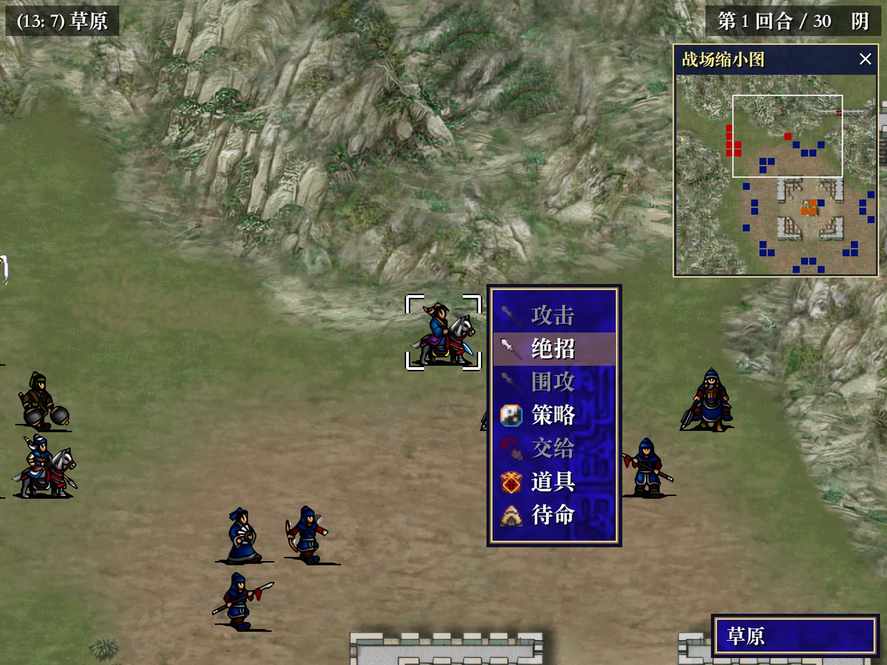
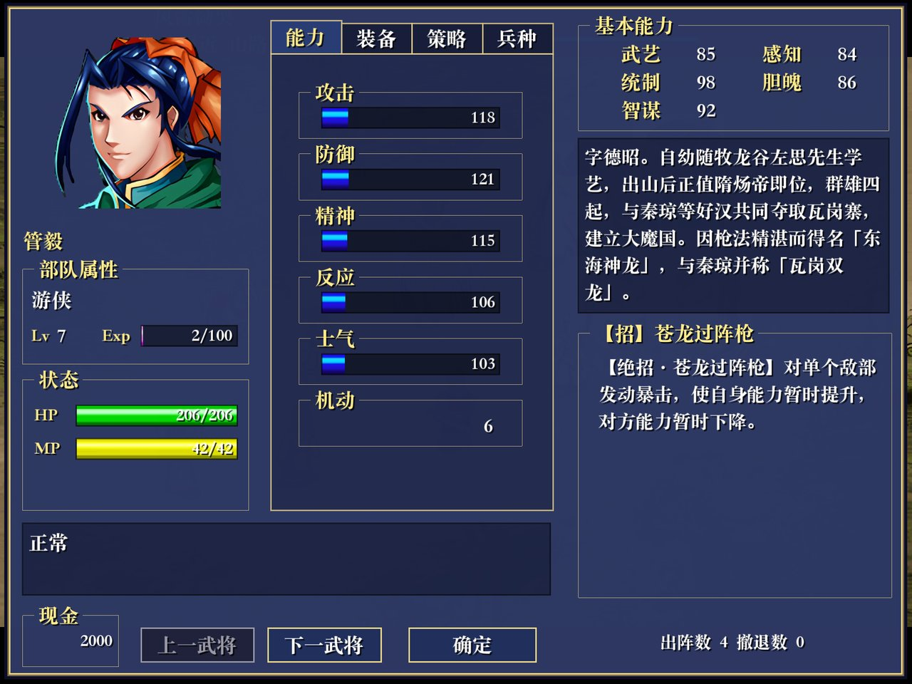
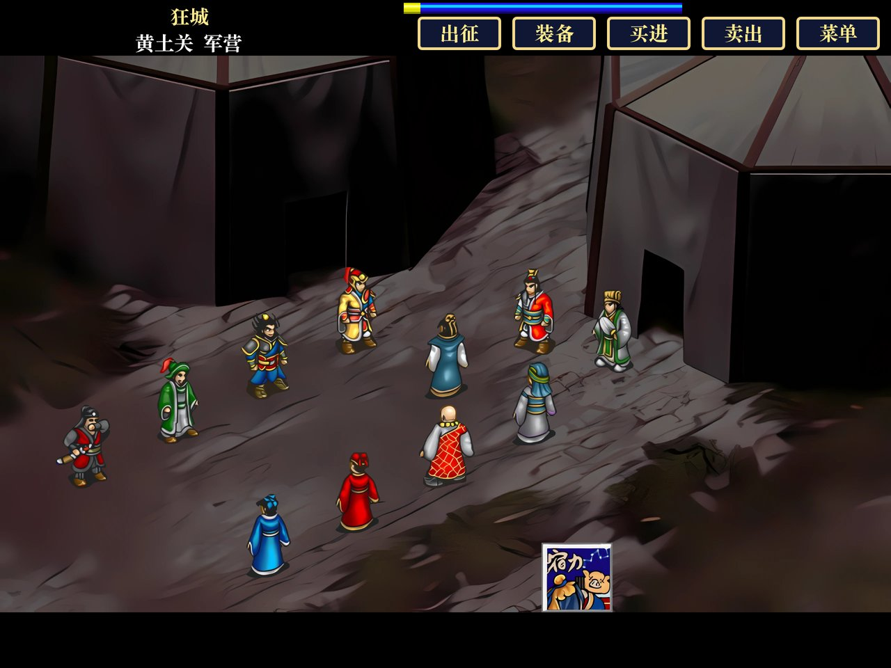
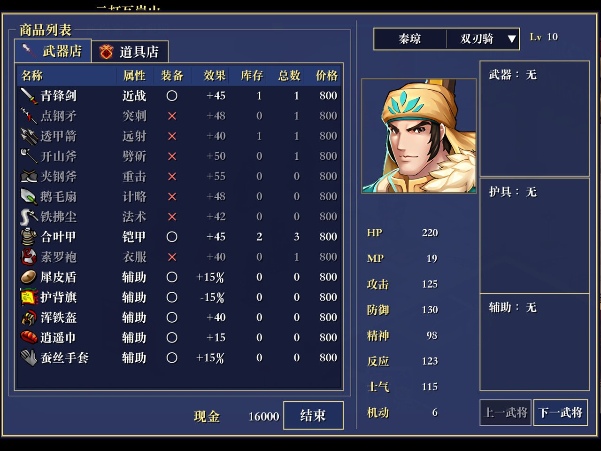
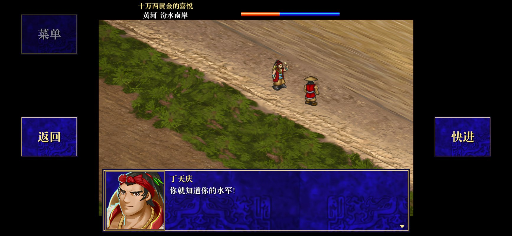
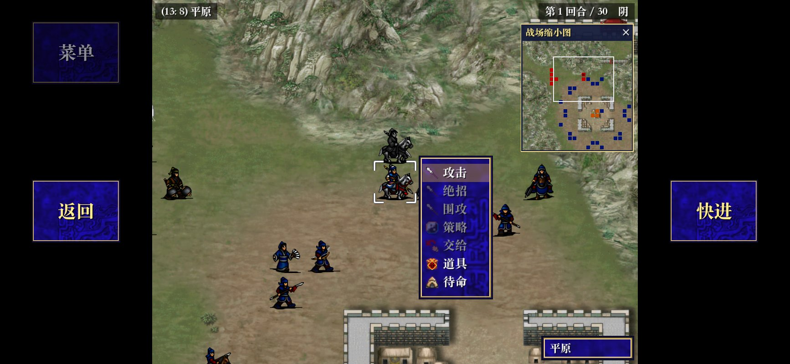

# 兴唐传·瓦岗山异闻录 — Godot 重制版

**中文** | [English](README.en.md)

隋唐题材战棋游戏《兴唐传·瓦岗山异闻录》的重制版，可以在 **Windows**、**macOS**、**iPhone** 和 **Android** 上直接玩。
原作是轩辕学院用光荣《三国志曹操传》引擎制作的 MOD。重制版照着原版程序重写，剧情、战斗规则、敌军 AI、商店和菜单都与原版一致，
画面全部经 AI 放大到 4 倍高清。

<p align="center">
  
  
</p>
<p align="center">
  
  
</p>

## 下载

到 [Releases 页面](https://github.com/seedds/wagang-godot/releases) 下载最新的 **Build N**。游戏每次更新都会自动发布新版本，
每个平台约 1.1 GB。

| 平台 | 文件 | 安装 |
|---|---|---|
| Windows（64 位） | `WaGang-Windows-build-N.zip` | 解压后运行 `WaGang.exe`（`WaGang.pck` 要在同一目录）。SmartScreen 提示“未知发布者”时，点“更多信息”→“仍要运行”。 |
| macOS（Apple 芯片 11+，Intel 10.13+） | `WaGang-macOS-build-N.zip` | 解压后打开。应用未经公证，第一次打开会被拦截：macOS 15 起到“系统设置 → 隐私与安全性”页面底部点“仍要打开”，更早的版本右键点应用选“打开”。 |
| iPhone（iOS 15+，iPhone XS 及更新） | `WaGang-iOS-build-N.ipa` | 安装包未签名，请用 AltStore 或 Sideloadly 安装（免费 Apple ID 每 7 天要重新签名一次）。 |
| Android（7.0+，64 位） | `WaGang-Android-build-N.apk` | 在手机上下载并打开，按提示允许安装。新版本可以直接覆盖安装，存档会保留。 |

## 游戏特色

* **完整的故事**：全部 117 个剧情与战斗脚本，从牧龙谷开场一直到各个结局。对话中的选择和战斗结果会改变剧情分支和结局。
* **原版的战斗**：曹操传的战棋规则，加上 MOD 新增的绝招、围攻、交给指令和众多武将各自的【技】【术】技能；敌军 AI 也与原版相同。
* **城镇与小游戏**：在城镇里买卖武器道具、换装备、选将出征、接支线任务；剧情中还有单挑、谜题等小游戏。
* **4 倍高清画面**：游戏里的所有图像都用 AI 放大到 4 倍（[原版与高清对比](docs/HD_GRAPHICS.md)）。
* **随时存档**：10 个存档位，剧情和战斗中都能存；另有自动存档，切到后台或关闭游戏时自动保存，标题画面选“继续游戏”就能接着玩。
  存档文件可以在电脑和 iPhone 之间复制。

<p align="center">
  
  
</p>

**手机版**横屏游玩，4:3 画面居中，两侧是“菜单”“返回”“快进”按钮，点按、拖动、长按就能玩：

<p align="center">
  
  
</p>

## 操作

| 电脑 | 手机 | 作用 |
|---|---|---|
| 左键 / 回车 | 点按 | 选择、确认、推进对话 |
| 右键 / Esc | 点空白处 / “返回” | 取消、后退 |
| Esc / 在空白处右键 | “菜单” | 系统菜单：存档、读档、结束回合、武将一览等 |
| 右键点人物 | 长按人物 | 武将情报 |
| 方向键 / 鼠标移到画面边缘 | 拖动 | 滚动战场地图 |
| 按住空格或 Ctrl | “快进” | 快进 |
| ⌘F / F11 / Alt+回车 | — | 全屏；拖动窗口边缘可以调整大小 |

Android 的返回键等同“返回”，不会退出游戏。各个菜单、战斗指令、武将技能、存档位置和常见问题见完整的
[游戏说明](docs/PLAYING.md)（英文）。

## 与原版的不同

玩法都按原版，只有以下几处是有意改动：

* 自动存档单独保存，不占用存档位（原版在每个我军回合结束后轮流覆盖 1–5 号存档）。
* 所有过场视频都可以跳过。
* 原版的 Windows 菜单栏和工具栏改成了游戏内的列表和顶部按钮，窗口一次只开一个。
* 通关或游戏结束后回到标题画面，而不是退出程序。

## 现状

* 整个游戏可以从开场玩到各个结局。所有脚本都经过自动通关测试，但还没有人工完整通关过。
* Windows 版还没有在 Windows 实机上测试过。
* 遇到问题欢迎在 [Issues](https://github.com/seedds/wagang-godot/issues) 反馈。

## 开发者

本项目用 Ghidra 反编译了原版程序（`wagan.wa`），把文件格式、剧本脚本语言、战斗公式、敌军 AI 和 MOD 对引擎的全部改动整理成文档，
再用 **Godot 4.7** 重新实现。游戏数据（剧本、地图、图像、音乐、音效、视频）都来自原作，只转换了格式。

从源码运行需要 [Godot 4.7](https://godotengine.org)（macOS 上可用 `brew install --cask godot`）：

```sh
git clone https://github.com/seedds/wagang-godot.git
cd wagang-godot
./run_game.sh      # 首次运行会下载高清画面包（约 720 MB）并导入项目，然后启动游戏
```

不用脚本的话，先执行一次 `godot --headless --path game --import`，再运行 `godot --path game`。

| 文档 | 内容 |
|---|---|
| [docs/PLAYING.md](docs/PLAYING.md) | 完整的游戏说明 |
| [docs/BUILDING.md](docs/BUILDING.md) | 从原版游戏重新转换数据；导出 macOS / Windows / iPhone / Android 版本；自动发布流程 |
| [docs/HD_GRAPHICS.md](docs/HD_GRAPHICS.md) | 4 倍高清画面包：生成、发布和模型选择 |
| [docs/MODDING.md](docs/MODDING.md) | 模组：把剧本、数据、图像或声音的改动打成 .zip 放进 mods 文件夹（英文） |
| [docs/ARCHITECTURE.md](docs/ARCHITECTURE.md) | 实现原理：模拟内存、脚本虚拟机、场景、界面 |
| [docs/DEVELOPMENT.md](docs/DEVELOPMENT.md) | 调试选项、自动通关测试、界面测试、逆向工作流程 |
| [docs/README.md](docs/README.md) | 逆向分析规格：文件格式、脚本指令、规则与 AI、MOD 补丁审计 |

`game/` 是 Godot 项目（`src/` 为源码，`assets/` 为转换后的游戏数据），`tools/` 是转换、测试和构建脚本，`.github/` 是自动发布流程。
原版游戏、构建输出和高清画面包不在仓库中。`docs/` 中的文档目前为英文。

## 法律声明

本项目是非官方的爱好者作品，仅用于保存和研究，与光荣特库摩及原 MOD 作者无关，也未获其认可。《三国志曹操传》版权归光荣特库摩所有。
`game/assets` 中的游戏内容（图像、音乐、音效、视频、文本、脚本）由原版游戏转换而来，版权归各自权利人所有。

本仓库暂无许可证文件，因此代码默认保留所有权利。如需允许他人复用 `game/src`、`tools` 和 `docs` 中的代码与文档，
需要添加 `LICENSE` 文件；该许可证不适用于 `game/assets`。
