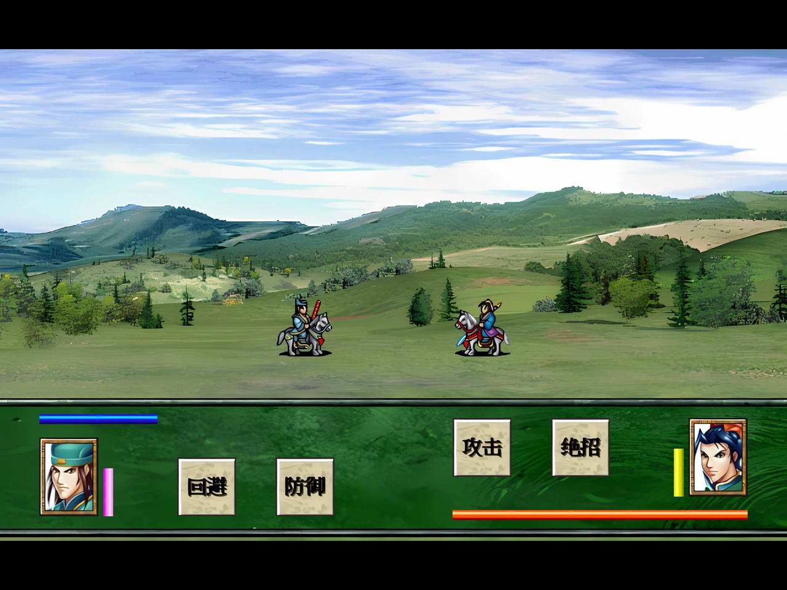
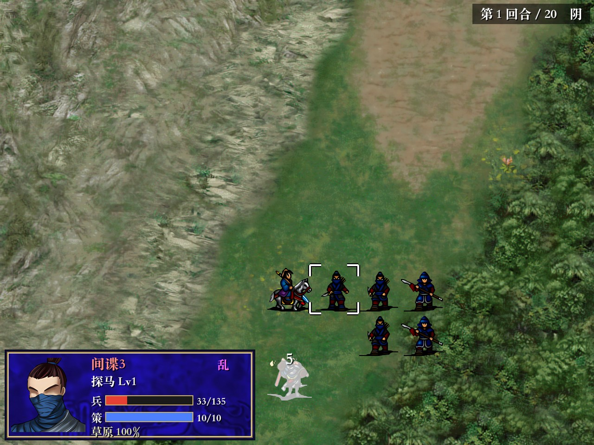

# Player guide

How to start the game and play it: story scenes, battles, duels, menus and saving. For building the app see
[BUILDING.md](BUILDING.md).

## Starting the game

* **Download (recommended):** the [Releases page](https://github.com/seedds/wagang-godot/releases) has a ready
  build for macOS, Windows, iPhone and Android for every update; take the newest *Build N*.
  * **macOS** (11+ on Apple Silicon, 10.13+ on Intel): unzip and open the app. It is not notarized, so macOS
    blocks it the first time. On macOS 15 and later open **System Settings → Privacy & Security**, scroll down
    and click **Open Anyway**; on older versions right-click the app → **Open**. Or run
    `xattr -dr com.apple.quarantine <app>`.
  * **Windows** (64-bit): unzip and run `WaGang.exe`; keep `WaGang.pck` in the same folder. If SmartScreen warns
    about an unknown publisher, choose **More info → Run anyway**.
  * **iPhone** (iOS 15+, iPhone XS or newer): `WaGang-iOS-build-N.ipa` is unsigned; install it with AltStore or
    Sideloadly, which sign it with your Apple ID (a free Apple ID needs re-signing every 7 days). With a developer
    account and a Mac, `tools/build_ios.sh --device` builds and installs it ([BUILDING.md](BUILDING.md)).
  * **Android** (7.0+, 64-bit ARM): download `WaGang-Android-build-N.apk` on the phone and open it; allow the
    browser or file manager to install apps when Android asks. Every build is signed with the same key, so a newer
    one installs over the old one and keeps the saves.
* **From source:** `./run_game.sh` in the repository root (needs Godot 4.7). The first run downloads the HD
  graphics pack (about 720 MB) and imports the project. See [BUILDING.md](BUILDING.md) to export an app yourself.

The window opens at the largest of 3×, 2.5×, 2×, 1.5× or 1× the original 640×480 that fits your screen. You can
resize it freely; when you let go, it snaps to the game's 4:3 shape so the picture fills it. Toggle full screen with
**⌘F**, **F11** or **Alt+Enter**.

On iPhone and Android the game runs in landscape: the 4:3 picture fills the screen height, with touch buttons on both
sides (see [Touch controls](#touch-controls-iphone-and-android)).

The title screen offers **继续游戏** (continue from the autosave, when there is one), **新游戏** (new game),
**读取进度** (load), **环境设定** (settings, see [Settings](#settings-环境设定)) and **结束游戏** (quit; not on iPhone
and Android). After an ending has
been reached once, the title picture changes. Downloaded builds show their version (版本 1.0.N) in the bottom-right
corner.

The game uses the 4× AI-upscaled HD art ([HD_GRAPHICS.md](HD_GRAPHICS.md)).

## General controls

| Input | Action |
|---|---|
| Left click / Enter | confirm, select, advance dialogue |
| Right click / Esc | cancel or go back; opens the menu where there is one |
| Right click on a unit or party member | **武将情报** (character information; see [Battles](#battles)) |
| Arrow keys / mouse wheel / Page Up, Page Down | move through menus (long lists scroll) |
| Tab / Shift+Tab, Space, arrow keys in 环境设定, 历史情报, 持有道具一览 and 部队情报一览 | as in the original's Windows dialogs: Tab moves between the controls (a dotted frame shows which), Space ticks the box or presses the button, the arrow keys pick the next radio button or move the list's selection (also Page Up / Down, Home, End), Enter presses the framed button |
| Hold **Space** or **Ctrl** | fast-forward animations and text (×4 game speed) |
| Click / Enter / Esc during a video | skip the cutscene |

### Touch controls (iPhone and Android)

| Touch | Action |
|---|---|
| Tap | a left click: confirm, select, advance dialogue, skip a video |
| Tap a battle cell | also shows its unit or terrain panel (what hovering does with a mouse) |
| Drag on the battle map | scroll the map; a drag never counts as a click |
| Drag up/down on a long list | scroll the list (history, unit list, items …) |
| Slide on a menu, lift | the entry under the finger is highlighted and picked when you lift it, so you can correct a near-miss before lifting |
| Hold a finger on a unit (½ s) | **武将情报**, like a right click on it; also on a party member in a story scene and on a name in 出场选择 |
| Tap an empty spot | cancel, like a right click: a tap outside a list closes it (outside the command list it takes the move back, as a right click does); outside the highlighted range while picking a target stops picking; outside the blue range drops the selected unit |
| **菜单** (top left) | the menu: in battle the system menu (end turn, unit list, objectives, save, load), in a story scene the scene menu. Only available when nothing is selected or open |
| **返回** (left of the picture) | cancel or go back, like Esc (also advances text and skips a video). Dimmed when 菜单 is available |
| **快进** (right of the picture) | fast-forward on/off: ×4 speed and text skips ahead, like holding Ctrl; the button is lit while on |
| Back button / gesture (Android) | what a right click does: like **返回**, or **菜单** where 返回 is dimmed. It does not quit the game; leave it with the home gesture |

Dialogue boxes show the speaker's portrait and name. With 讯息显示速度 快 (the default) a page appears at once,
otherwise it types out and a click shows the rest; the next click continues (or the page closes by itself when
会话窗口不自动关闭 is off). Short notices close by themselves after a second or so; a click closes them sooner.

### Settings (环境设定)

On the title screen and in the menu. Switches for background music (听背景音乐) and sound effects (听音效); 战斗时，
自动显示战场缩小图 opens the battle minimap at each battle start; 会话窗口不自动关闭 makes dialogue wait for a click;
升级显示能力成长 lists every stat change on a level-up; 讯息显示速度 and 武将移动速度 (快 / 普通 / 慢); 对话框花色 the
background pattern of the windows (花色１–４ or 无). The settings are kept for all saves, as in the original. 战斗时，
窗口自动最大化 is the original's window option and has no effect here.

## Story scenes

Story scenes alternate with battles. Some play out on their own as cutscenes. In others you walk around a town or
camp and click characters and places to talk to them or go somewhere. These scenes keep waiting until you do the
thing that moves the story on, such as talking to a particular person.

While a scene is waiting for you:

* **菜单** (top right, or right click / Esc) opens the menu:
  * **武将一览** – the party in a sortable table (class, level, HP, MP, stats); click a row for its 武将情报 (also:
    right-click a party member in the scene)
  * **持有道具一览** – the warehouse and what everyone wears (武具一览) and the consumables (道具一览); click an item
    for its details
  * **地形情报一览** – what each terrain means to each kind of unit (地形效果, 消耗机动力) and which element strategies
    work there
  * **历史情报** – the chronicle, coloured by kind; 按顺序显示 switches between written order and by kind
  * **环境设定** – the settings
  * **存储进度 / 读取进度** – save or load
  * **版本情报** – the game's version box
  * **回到标题** – back to the title screen
* When the next battle is ready the top bar shows the town's buttons (they can be missing in some towns):
  * **装备** – the warehouse on the left, the chosen character on the right. Pointing at a piece shows how the
    stats would change; a click puts it on (the old piece goes back to the warehouse), a click on a worn piece takes
    it off; a right click shows an item's details. Pieces a character cannot wear are greyed with a red ×.
  * **买进** – the shop: 武器店 (equipment, bought for the character on the right and worn at once; it must be able
    to wear it) and 道具店 (consumables, with a count). With 贾润甫 in the party everything costs 20 % less.
  * **卖出** – sell warehouse equipment or consumables. Selling a plain (not treasure) weapon or armour at Lv 3 earns
    a fruit as well.
  * **出征** marches out. If more members are available than the battle allows, the sortie screen (选择武将) lets you
    choose who goes: click a character to add or remove it, at least two thirds of the places must be filled; the
    sort buttons order the grid, **战场位置** shows the start positions on the coming map, **取消** stays in town.
    Required members are pre-selected and stay.

Hub towns have shops, side quests and optional characters. Some scenes contain **mini-games**:

* **单挑 duels** – a side-view fight where you click **攻击** (attack), **防御** (defend), **回避** (evade) or
  **绝招** (special, once its gauge allows). Losing usually ends the game, so save before risky fights.
* **Puzzles** – e.g. ordering lines of a poem.
* **A dice game** in a gambling house.

Choices matter: many dialogue choices and battle outcomes change story flags and hidden scores. Those decide later
branches and which of the endings you reach.

## Battles

  
  

Each battle starts with its victory and defeat conditions (胜利条件 / 失败条件). Turns go: **your phase**, then
**allied** (green units), then **enemy** (blue units). Your units are red.

**Your phase**

1. Click one of your units. **Blue** cells show where it can move, **red** cells what it could attack from there.
2. Click a blue cell to move (click the unit's own cell to stay).
3. Pick a command:
   * **攻击** – attack; click a target inside the red range. Spear and some cavalry classes also hit the unit
     behind the target, 无影剑 the units around it.
   * **绝招** – a character's special move (管毅, 程咬金 once he has learned 三板斧, 伍云召, 雄阔海, 秦琼, 伍天锡,
     罗成, 裴元庆, 尉迟恭). It needs a full MP bar and uses all of it; every move is different (e.g. 罗成's
     回马枪 needs a move first, 伍天锡's hits everyone around him).
   * **围攻** – siege: the target is attacked by the unit and then by every ally next to it that has not acted yet
     (they lose their turn); the target counters once. Enemies do this too.
   * **策略** – cast a strategy (uses MP); pick it, then the target or area. The menu shows the hit chance.
   * **交给** – give the unit's accessory to a neighbour (樊虎 hands out accessories from the warehouse).
   * **道具** – use an item on the unit or a neighbour (items work only in battle). A fruit raises a stat (not past
     100), 仙人果 gives experience (not past Lv 70), 印绶 promotes the class at Lv 20 / 40.
   * **待命** – wait. Right-clicking in the command menu takes the move back.
   * Items: 六军镜·形势 gives a second attack, 六军镜·权谋 a second strategy at double MP, 六军镜·阴阳 another move
     after acting, 六军镜·技巧 绝招 without a full MP bar.
4. Once every unit has acted you are asked whether to end the phase (结束所有部队的命令吗？), or end it early from
   the system menu.

**Information**

* Hover over a unit or cell to see its panel: portrait, class and level, troops (兵), MP (策), status effects
  (毒 poison, 乱 confusion, 麻 paralysis, 封 seal, 怯 fear) and the terrain bonus.
* Click an enemy or ally to show its movement and attack ranges.
* **Right-click any unit** (yours, allied or enemy; hold a finger on it on a phone) for its **武将情报** window:
  portrait, class, level and experience, current troops (HP) and MP, status (混乱, 中毒 … and raised or lowered
  stats, 行动完毕 once it has acted), the five base abilities (武艺 统制 智谋 感知 胆魄), biography, its special
  skill (技能), sorties and retreats, and four pages:
  * **能力** – 攻击 / 防御 / 精神 / 反应 / 士气 with equipment; a raised or lowered stat shows "battle value/base"
    (cyan or red under the bar), and 机动 the move points (± 2 when raised or lowered);
  * **装备** – weapon, armour and accessory with level, experience and effect; click one for its details (属性,
    价格, 效果, which unit types can use it);
  * **策略** – the strategies it knows with their MP; click one for its effect, MP cost, range and area;
  * **兵种** – the class: weapon and armour kinds, growth grades (C/B/A/S/X) for the five stats, move, attack range
    and description.

  **上一武将 / 下一武将** step through the units of the same side (yours and allies, or the enemy) on the map. ←/→
  change the page, Page Up/Down (or Q/E) the unit; Esc, a right click or **确定** close it. The same window opens
  from **武将一览**, by right-clicking a party member in a story scene, and by right-clicking a character in 选择武将.
* Turn number, turn limit and weather are shown top right.

* A left click on an empty cell shows its terrain: name, whether it heals (可以恢复) or cannot be entered (无法移动),
  and which element strategies (fire, water, earth, wind) work there. The cursor's cell and terrain are shown top
  left.

**System menu** (Esc, or a right click on an empty cell; **菜单** on a phone): **结束回合** (end the phase, after a
yes/no), **检索未执行部队** (jump to the next unit that has not acted), **武将一览** (sortable unit table, 我军 / 敌军),
**持有道具一览**, **地形情报一览**, **历史情报**, **胜利条件** (objectives; the goal area blinks again), **战场缩小图**
(the minimap: drag its frame to scroll the map), **环境设定**, **存储进度 / 读取进度** (save / load), **版本情报**,
**回到标题** (title). When none of your units can act any more you are asked whether to end the phase; answer 否 to
look around first.

**Moving around the map:** arrow keys move the cursor; the mouse at a screen edge or a middle-button drag scrolls.
On a phone drag the map with a finger; tapping a cell shows its unit or terrain panel.

**Character skills.** Many characters have a skill (技能, shown in 武将情报) that works on its own:
* **Techniques (【技】)** trigger at the start of an attack, the more likely the higher the attacker's 士气 is
  against the target's, with a name banner: e.g. 尉迟恭 attacks up to three times while the target strikes back,
  李元霸 hammers everyone around him and frightens and seals the whole area, 宇文成都 and 新文礼 hit the units around
  or beside the target, 杨林 lowers a weapon or armour level, 魏文通 freezes the target's movement, 单雄信 drains its
  MP. 定彦平 and 东方伯 lure the target into striking first and answer with a double blow; 姜松 strikes first when
  attacked.
* **Auras at the start of a side's phase:** 鲁明月 heals and 柳周臣 restores MP to the allies around them, 尚师徒
  raises their attack, every 雄师 their morale, 魏征 cures their ailments; the enemy's 杨素 poisons the units around
  him.
* **Other skills:** 鲁明星 and 鲁明月 grow stronger near 管毅 and each other, 王君珂 with every hit 管毅 took in the
  enemy turn, 王伯当 below 60 % troops, 罗成's attacks add a part of his 精神 (even a miss scratches). 房玄龄 halves
  the MP cost of allies next to him, 杜如晦 raises their hit chance. 罗士信 and 齐国远 strengthen or train the
  equipment of allies they walk through, 贾润甫 gives mounted allies one more move, 单雄信, 张公瑾 and 丁天庆 cross
  terrain more easily, and some weapons grow stronger in town as the story goes on (宿痕).
* Defeated enemies sometimes leave 辰屑 (a crafting material the story uses).

**General rules worth knowing.** Units of the 格斗 classes (武师, 教头, 团练) grow quicker, 燕云骑 tougher, 战车
harder-hitting and 狄骑 both, by 15 % for each ally of the same family on the 8 cells around them (组阵). 反应 and
士气 equipment adds a percentage of the stat. A unit carrying 笼屉 eats a 馒头 when it has lost 100 troops or more
(yours from the bag), 天玉玲珑铠 hits harder for each blow its wearer took since the enemy's last turn, a 引导攻击
weapon goes on to the next target in reach whenever the target falls, and 孙子兵法 lets its holder cast the
strategies of the units beside it. 轩辕宝鉴 and 天闻录 train the weapon or the armour every turn.

Units that run out of troops retreat; some characters have scripted retreat lines. Experience comes from fighting
and casting; at 100 EXP a unit levels up ("X升为N级。", and "学会了策略「…」！" for a new strategy). Officers well above
the army's average level gain less troops and MP from a level-up. From level 20 (and again from 40) a promotion
item raises the unit to the next class. Weapons and armour gain levels with use.

Many battles have scripted events: reinforcements, ambushes, weather changes, objectives that change mid-battle,
traps, and duels triggered when two particular units stand next to each other.

## Duels (单挑)

When the story calls for it, two officers duel on a separate screen: an introduction, then the fight with speech
bubbles. Duels are scripted and play by themselves. Text advances on a timer; click to finish a line early. The
winner may gain experience when the duel closes.

## Saving and loading

* **10 save slots**, from the story menu or the battle system menu, including mid-battle. During some story
  sequences the game does not allow saving and says 目前不可存盘。, as the original does. Loading works from the
  title screen or in-game.
* Saves are stored as `save_00.json` … `save_09.json` (each with a small `save_NN.info.json` summary for the slot
  list) in the game's user folder:
  * macOS: `~/Library/Application Support/Godot/app_userdata/兴唐传·瓦岗山异闻录/`
  * Windows: `%APPDATA%\Godot\app_userdata\兴唐传·瓦岗山异闻录\`
  * iPhone: the app's own folder, visible in the **Files** app under **On My iPhone → 兴唐传·瓦岗山异闻录**
    (or in Finder's iPhone *Files* tab), so saves can be copied to and from a computer
  * Android: the app's private storage; it survives updates but is deleted when the app is uninstalled

  The file `niuniu.bin` there records reached endings, as the original's `Niuniu.wa` did. Saves can be copied
  between the macOS, Windows and iPhone versions. A save is written to a temporary file first, so a crash while saving
  leaves the old save intact; a damaged save, or one from a newer version of the game, is refused instead of
  loaded.
* **Autosave**: the game keeps `autosave.json` (same folder) and writes it when the app goes to the background,
  loses focus or is closed, when you return to the title screen or quit, at the start of every scenario, and at most
  once a minute while playing, so on a phone it is safe to switch away or swipe the app closed at any time. **继续游戏** on the title screen resumes it. A running
  scene cannot be saved halfway, so it resumes at the last point where the game waited for the player: a story
  scene waiting for a click, the battle's player phase with nothing selected, or the start of the scenario. It
  does not use one of the 10 slots.
* A defeat (game over) or an ending (全剧终) returns to the title screen; 继续游戏 then resumes from the last
  autosave, e.g. to try a battle or a choice again.

## Troubleshooting

| Problem | Fix |
|---|---|
| macOS: "App can't be opened" / "Apple could not verify…" | macOS 15+: **System Settings → Privacy & Security → Open Anyway**; older: right-click → **Open**; or `xattr -dr com.apple.quarantine <app>` |
| Windows: SmartScreen "Windows protected your PC" | **More info → Run anyway** (the build is not code-signed) |
| Windows: the game starts with an error about a missing pack | Keep `WaGang.pck` next to `WaGang.exe` (unzip the whole folder) |
| Window too small or large | Drag the window's edge or corner (it snaps to 4:3), or toggle full screen (⌘F) |
| Missing characters (▯) in text | The game uses system Chinese fonts: Songti SC, Hiragino Sans GB and Heiti SC on macOS (make sure they are not disabled in Font Book); SimSun, Microsoft YaHei and SimHei on Windows (install the Chinese supplemental fonts if your Windows lacks them). The iPhone version brings its own (Noto Serif SC) |
| A town scene "does nothing" | It is waiting for you: find the character or place that continues the story, or look for **出征** in the top bar |
